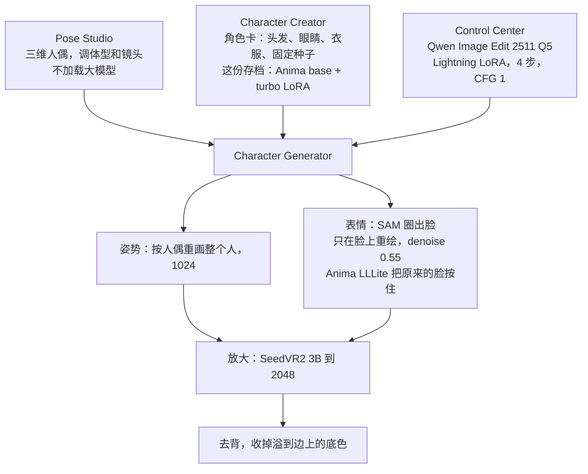
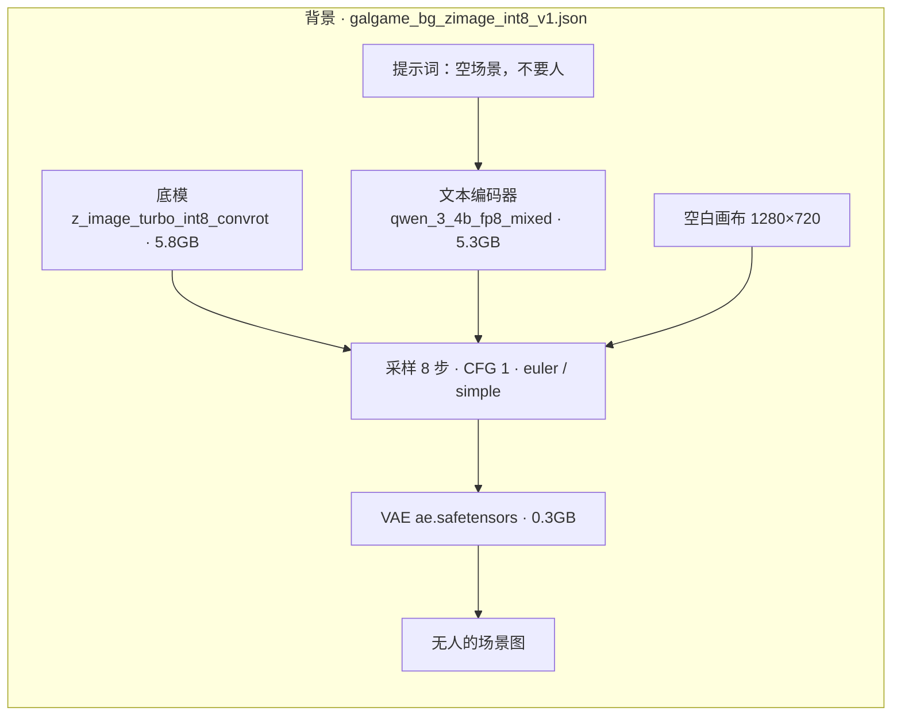
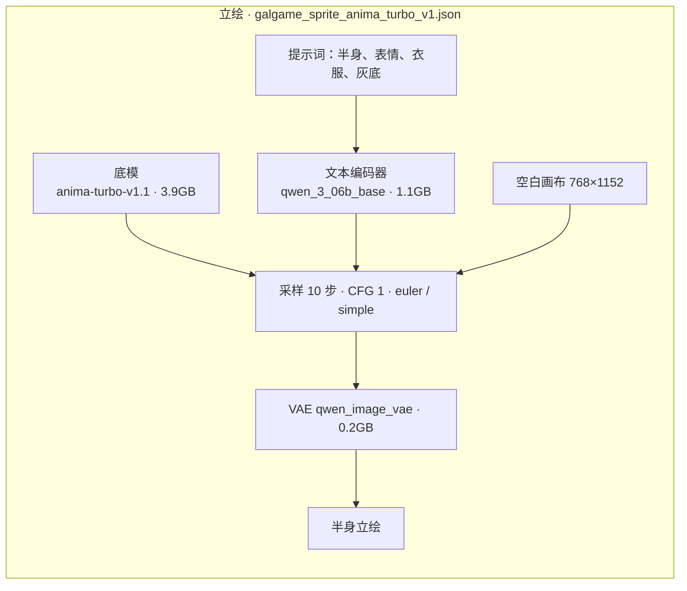
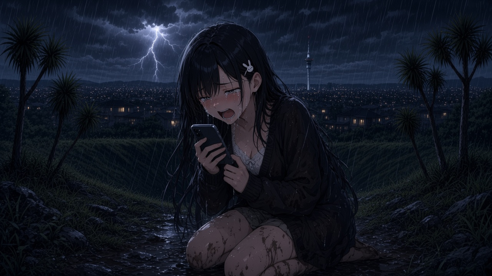
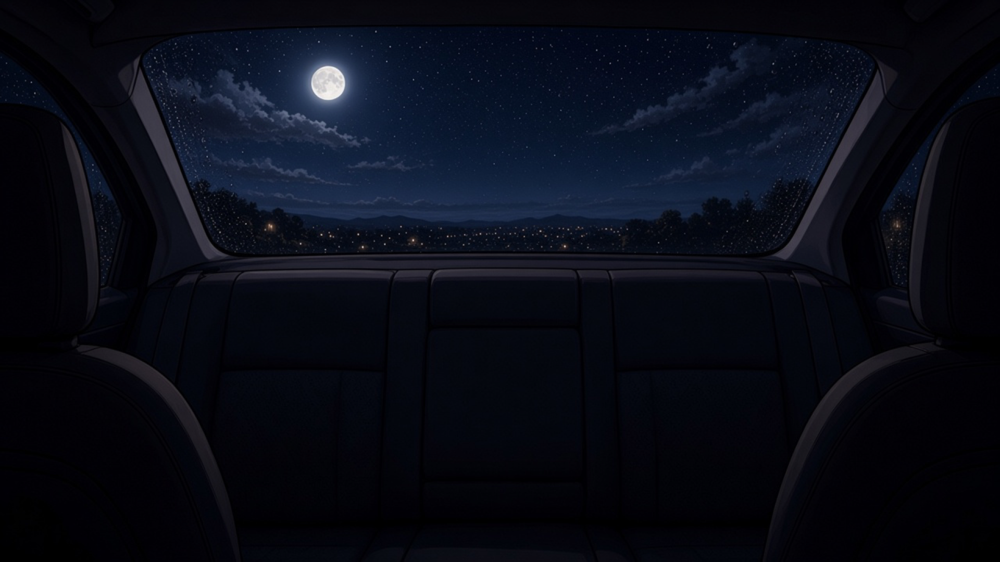
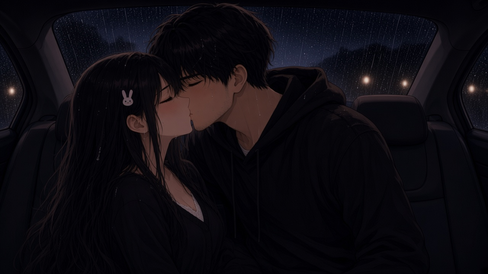
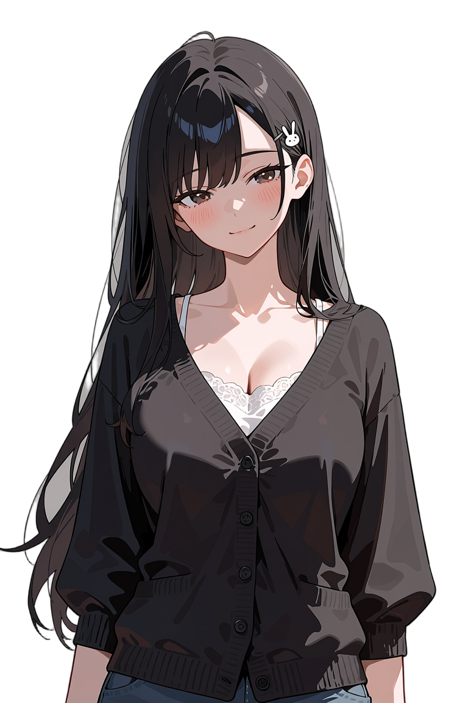

# 大康兔 Dakangtu

这是一次用本地 ComfyUI 工作流做视觉小说的试验。问题是：背景、立绘、表情要分开画，同一个人还得能对上，一台机器的内存又放不下全部模型。结果是一款能玩的 Galgame，以及下面这些进了游戏的画面。

> 版本 **1.5**。Act 1「落日和明天」、Act 2「相见有期」、Act 3「雨落星河」。主菜单「开始第一章」进入 Act 2，「开始第二章（生日快乐）」进入 Act 3。

在浏览器里玩：[xuwupeng2000.itch.io/dakangtu](https://xuwupeng2000.itch.io/dakangtu)

引擎是 Ren'Py 8.5.3。出图在 ComfyUI。立绘去背用 BiRefNet，再用 pymatting 收边。

---

## 做了什么

剧情是两段隔了很久的重逢，分成三幕，装进同一个游戏里。画面分两台机器做。

Act 1 和 Act 2 在另一台机器上完成。背景用 Z-Image 的完整权重，画布就是游戏的 1920×1080。立绘用 VNCCS：先定一张角色卡，再用人偶摆姿势，表情只改脸。同一台机器上也跑过 SDXL 的像素对比、Wan 的动态背景，以及自动修图。能从进游戏的文件名对上的，是 Z-Image 背景和 VNCCS 立绘。Act 1 的背景叫 `zimage_anime_bg_*`、`zimage_anime_v5_*`。LX 用的 Rita 立绘叫 `sprite_表情_000N`，这是 VNCCS 一次导出一组表情的名字。

后来换到这台 16GB 统一内存的 Mac。完整的 Z-Image 底模是 11.5GB，Qwen Image Edit 的 Q5 大约 14.3GB，采样时都要整份留在内存里，装不下。于是另写了两条小工作流：背景换成 INT8，立绘用 Anima Turbo 从空白画布直接画。这两条不是 Act 1、Act 2 的成图流程。

---

## 方式

### 完整机：Z-Image 背景

`workflows/galgame_bg_zimage_anime_template.json`

底模 `z_image_turbo_bf16`，文本编码器 `qwen_3_4b`，VAE `ae.safetensors`。空场景，1920×1080，10 步，CFG 1，euler / simple。提示词里写明不要人。CFG 为 1 时，负面提示词基本不起作用，限制得写在正面。

### 完整机：VNCCS 立绘

`workflows/VNCCS_3.0_new_char_creator.json`

VNCCS 把「同一个人、很多姿势、很多表情」收成一张角色卡。人偶那一步几乎不花算力。贵的是按人偶把人重画一遍。



这份存档的第一张图用 Anima：底模 `anima-base-v1.0`，LoRA `anima-turbo-lora-v0.1`，编码器 `qwen_3_06b_base`，VAE `qwen_image_vae`，12 步，CFG 1，采样器 er_sde，种子固定。关掉 turbo LoRA 就回到 30 步、CFG 4。另一个后端是 Illustrious 的 `ILFlatMix`，20 步，CFG 8。

人偶导出 640×1536 的姿势图，提示词是按第二张图里的角色来画。这一步用的是 Qwen Image Edit，不是 Anima。表情不重画全身：SAM 圈出脸，只在脸上以 0.55 的强度重绘，`anima-lllite-any-test-like-v2` 在前 90% 的步数里按住原来的五官。放大可以是 SeedVR2 3B Q4 到 2048，也可以换成 4 倍 APISR。

### 这台 Mac：两条小工作流

16GB 统一内存里一次只留一条。文本编码器读完提示词就卸掉，采样时主要占着底模。两条都从空白画布整张生成，denoise 是 1.0。





| 文件 | 哪一条 | 干什么 | 体积 | 什么时候占内存 |
|---|---|---|---:|---|
| `z_image_turbo_int8_convrot.safetensors` | 背景 | 底模。Z-Image Turbo 的 INT8 | 5.8GB | 采样全程 |
| `qwen_3_4b_fp8_mixed.safetensors` | 背景 | 文本编码器。Qwen3 4B 的 FP8 | 5.3GB | 读完提示词就卸 |
| `ae.safetensors` | 背景 | VAE | 0.3GB | 最后出图 |
| `anima-turbo-v1.1.safetensors` | 立绘 | 底模。没有再量化 | 3.9GB | 采样全程 |
| `qwen_3_06b_base.safetensors` | 立绘 | 文本编码器。Qwen3 0.6B | 1.1GB | 读完提示词就卸 |
| `qwen_image_vae.safetensors` | 立绘 | VAE。不能换成背景那份 `ae` | 0.2GB | 最后出图 |

INT8 和 FP8 在这台 Mac 上要装 `ComfyUI-AppleSilicon-FP8`。Anima 不用。`nvfp4` 是 NVIDIA 的格式，这里不能用。

---

## 结果

游戏可以玩。三幕剧本都在里面，版本 1.5，发布在 [itch.io](https://xuwupeng2000.itch.io/dakangtu)。

下面是第三幕「雨落星河」里正在用的画面，直接取自 `game/images/`。

<p align="center">
  
  <br>山顶，南十字
</p>

<p align="center">
  
  
  <br>月下山路 · 夜里看消息
</p>

<p align="center">
  
  
  <br>雨里 · 雨停后的后座
</p>

<p align="center">
  
  <br>后座
</p>

<p align="center">
  
  
  <br>Ami · Jack
</p>

Act 1 的成图还在 `game/images/backgrounds/act1/` 和 `game/images/characters/rita/`。那一组表情是同一次角色卡导出的，衣服和脸能对上。

---

## 经验

三条流程解决的不是同一件事。Z-Image 负责空场景。VNCCS 负责把同一个人做成一组立绘。Mac 上的两条只负责在 16GB 里还能出一张图。

**Z-Image 全精度适合做背景，不适合锁一场戏。** 1920×1080 和游戏分辨率一致，场景里可以不放人。每一张都是新的采样，同一间房间再跑一次，窗户和灯光会对不齐。完整底模 11.5GB，加上 7.5GB 的编码器，这台 Mac 跑不了。

**VNCCS 能保住衣服和表情的关系，代价是一次全身重画。** 角色卡把种子、头发、衣服固定下来。换表情只动脸，身体留在蒙版外面，所以一组 `sprite_表情_000N` 看起来是同一个人。换姿势则要把整个人按人偶重画，身份会不会漂，取决于 Qwen Image Edit 认不认第二张参考图。Q5 大约 14.3GB，这台 Mac 装不下。脸上的 denoise 是 0.55，五官仍可能偏一点。角色卡如果用绿色底板，头发边上会留一圈，事后用 BiRefNet 也收不干净，因为那圈颜色已经画进头发里。

**空白画布的 Anima 轻，也因此会跑。** 3.9GB，10 步，这台 Mac 放得下，适合试一张半身、看一个造型。它没有参考图，没有锁脸，也没有人偶。改一个表情词，脸、头发、衣服会一起变。它不能代替 VNCCS 来做一组要互相切换的立绘。

**量化换来的是能跑，不是同一张画。** 背景底模从 bf16 的 11.5GB 压到 INT8 的 5.8GB，细线和远处的小东西更容易糊、更容易断。编码器从 7.5GB 压到 FP8 的 5.3GB，长提示词的后半句跟得没那么紧。画布还缩到 1280×720，放进 1920×1080 会被放大。步数只有 8 步和 10 步，手、小物件和画面里的字最容易坏。两条不能同时留在内存里。

**去背要在底色还在的原图上做。** BiRefNet 加 pymatting 能去掉纯色底。底色如果和头发、衣服太接近，边缘会咬进身体，或者留下一圈。已经抠过、再带着色边的图，不能当第二次抠图的输入。

---


```
Dakangtu/
├── game/
│   ├── act1.rpy act2.rpy act3.rpy
│   ├── images/backgrounds/act1/   # Z-Image 全精度背景
│   ├── images/characters/rita/    # VNCCS 表情组，Act 1 的 LX
│   ├── images/backgrounds/act3/   # 第三幕场景
│   ├── images/cg/act3/            # 第三幕 CG
│   └── images/characters/         # ami、ami_adult、jack
├── workflows/
│   ├── galgame_bg_zimage_anime_template.json  # 完整机背景
│   ├── VNCCS_3.0_new_char_creator.json        # 完整机立绘
│   ├── galgame_bg_zimage_int8_v1.json         # 这台 Mac 的背景
│   └── galgame_sprite_anima_turbo_v1.json     # 这台 Mac 的立绘
└── tools/
```

本地打开游戏：用 Ren'Py 加载这个目录。完整机的两条工作流和这台 Mac 的两条，都在 `workflows/` 里，一次只加载一条。

---

## License

个人学习项目，未授权商用。
